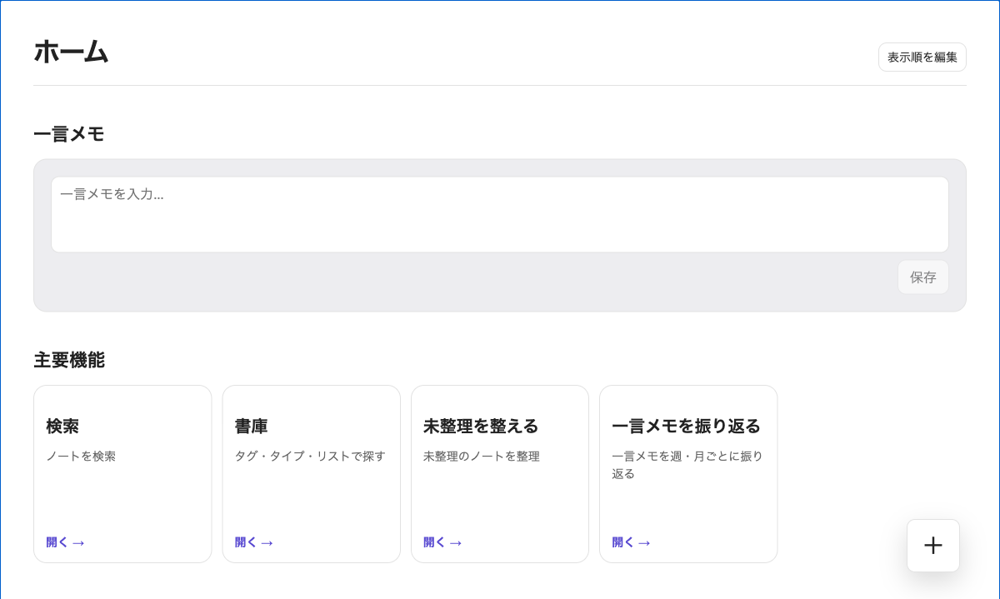
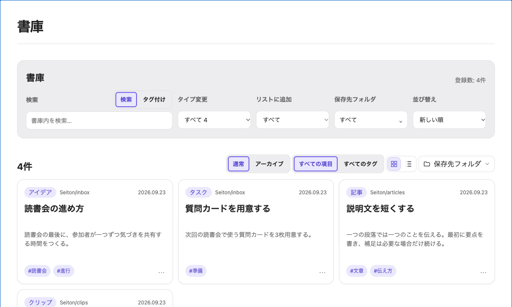
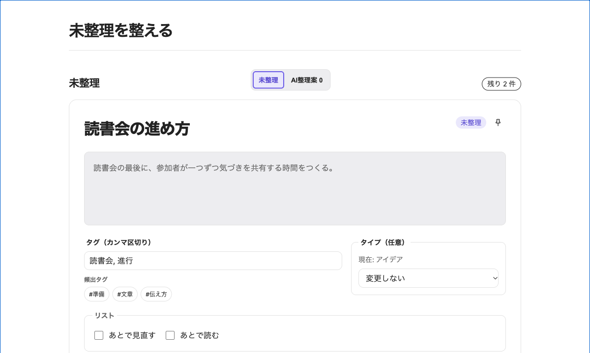

# Seiton

[English](README.md) · [日本語](README-ja.md) · [Deutsch](README-de.md) · [Español](README-es.md) · [Français](README-fr.md) · [한국어](README-ko.md) · [Português](README-pt_BR.md) · [简体中文](README-zh_cn.md)

迷わず残し、あとから見つけて使う。

Seitonは、メモ・資料・タスク・読書記録をMarkdownのままVaultに残し、必要なときに探し直すObsidianプラグインです。保存時にフォルダやタグを決めきれない内容は未整理に置き、あとからSeitonの画面で振り分けられます。

> 掲載画像は架空のサンプルノートで作成しています。現在、Obsidianコミュニティプラグイン一覧には未登録です。


## 開発版を導入する

Obsidian 1.13.7以降が必要です。ソースからのビルドにはGit・Node.js・npmも使います。コミュニティプラグイン一覧からはまだ導入できません。

1. ソースを取得し、ビルドします。

   ```sh
   git clone https://github.com/ishibashi-c/obsidian-seiton.git
   cd obsidian-seiton
   npm ci
   npm run build
   ```

2. `<Vault>/.obsidian/plugins/seiton/`を作成し、リポジトリ内の`main.js`、`manifest.json`、`styles.css`をコピーします。
3. Obsidianを再読み込みし、「設定 → コミュニティプラグイン」でSeitonを有効にします。初回設定で言語、使うタイプ、追加機能を選びます。

## 記録して、見つけて、整理する

1. ホームから一言メモを残すか、タイプを選んでノートを作成します。
2. 分類に迷う内容は未整理に置いておきます。タイプ・保存先フォルダ・タグをすぐに決める必要はありません。
3. Seiton内のノートと設定済みの追加フォルダを検索するか、書庫でフォルダ・タイプ・タグ・リストから探し直します。
4. 必要になったら未整理画面で保存先やメタデータを整えます。不要になったノートは、Seitonからアーカイブへ移動できます。

### 使う追加機能を選ぶ

ホーム、検索、書庫、未整理の整理、アーカイブが、記録から再利用までの基本の流れを支えます。本棚、一言メモの振り返り、リッチカード、エディターツールバーなどは設定から個別に有効・無効を切り替えられます。

<details>
<summary>ホーム・書庫・整理画面の画像を見る</summary>







</details>

## ノートの保存と通信

ノートはVault内の通常のMarkdownファイルです。Seitonは未知のfrontmatter項目を保持し、通信できないときもローカルのノートを使えます。記録・検索・整理にAIは必要ありません。

### 外部AIツールを使う場合

SeitonにAIモデルは内蔵されておらず、Vaultの内容をAIへ送信することもありません。外部AIツールを使う場合は、Markdownの整理案を作成してもらい、Seiton上で移動先やタグなどを確認してから適用できます。整理案を使わず、手動で整理することもできます。

### ネットワークを使う機能

アカウント、アナリティクス、テレメトリ、広告、内蔵LLMはありません。通信はWebクリップのメタデータ取得、書誌検索、任意の日本語蔵書検索など、機能を使うときに限られます。送信先とデータの詳細は[通信とプライバシー](docs/privacy-and-network.md)を参照してください。秘密情報を含むURLはWebクリップに保存しないでください。

Webクリップでは保存したページと画像の配信元から情報を取得し、代替のドメインアイコンにはGoogleのfaviconサービスを使います。ISBNの書誌情報と表紙にはopenBDとOpen Libraryを使い、書名・著者の検索にはOpen Libraryを使います。

カーリルの蔵書検索と国土地理院の市区町村・住所検索は、日本語UI限定・日本国内の図書館向けです。カーリルには利用者自身のAPIキーが必要です。他の表示言語では図書館機能を表示しません。本棚と書誌検索は他の言語でも使えます。

## 開発する

| コマンド | 用途 |
|---|---|
| `npm test` | テストを実行 |
| `npm run build` | 型検査とプラグインのビルド |
| `npm run harness` | UI Labを起動 |
| `npm run lint` | lintを実行 |
| `npm run release:check` | テスト・本番とUI Labのビルド・公開用ファイルの整合性を確認 |

[製品仕様](spec.md) · [実装ロードマップ](docs/implementation-roadmap.md) · [UI Labの画面・fixture対応表](docs/ui-mock-map.md) · [リリースチェックリスト](docs/release-checklist.md) · [開発上の制約と検証条件](AGENTS.md)

## ライセンスとデータ提供元

MIT © 2026 IshibashiCustomize。[LICENSE](LICENSE)と[第三者ライセンス表記](THIRD_PARTY_NOTICES.md)を参照してください。書誌情報と表紙画像の提供元：[openBD](https://openbd.jp/)、[Open Library](https://openlibrary.org/developers/api)。
